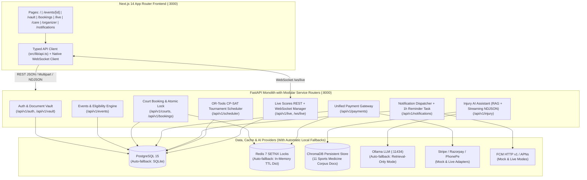

# Sports Hub Platform MVP

An end-to-end sports super-app where athletes, coaches, referees, and tournament organizers can discover sports events, maintain a verified **Document Vault** (`ID`, `MEDICAL`, `WAIVER`), register in one click once automated eligibility checks pass, book facility courts with atomic slot locks, complete multi-gateway payments, receive push/in-app notifications, follow real-time WebSocket live scores, consult a RAG-powered **Injury-Prevention AI Assistant**, and auto-generate conflict-free tournament schedules with **Google OR-Tools CP-SAT**.

---

## 1. Three-Command Quick Start (Zero Docker, Zero API Keys Required)

By default, the platform automatically falls back to **SQLite** (`sportshub.db`), an **in-memory TTL lock cache**, **Mock Payment Mode**, **Mock Notification Mode**, and **ChromaDB Retrieval Fallback** if PostgreSQL, Redis, or Ollama are not running.

### Windows (PowerShell)
```powershell
# 1. Install backend dependencies & start FastAPI (Port 8000)
cd backend; python -m venv .venv; .\.venv\Scripts\pip install -r requirements.txt; Start-Process .\.venv\Scripts\python -ArgumentList "-m","uvicorn","app.main:app","--reload","--port","8000"

# 2. Install frontend dependencies & start Next.js (Port 3000)
cd ..\frontend; npm install; npm run dev

# 3. Run the automated end-to-end Smoke Test suite
cd ..; .\backend\.venv\Scripts\python scripts\smoke_test.py
```
*(Or simply run `.\scripts\start_all.ps1` from the project root!)*

### macOS / Linux (Bash)
```bash
# 1. Setup & start Backend + Frontend
chmod +x scripts/start_all.sh && ./scripts/start_all.sh

# 2. (Or via Makefile)
make setup && make run-backend & make run-frontend

# 3. Run E2E smoke test
python3 scripts/smoke_test.py
```

### Switching to PostgreSQL 15 + Redis 7 via Docker Compose
```bash
docker-compose up -d
cp .env.example .env
# Uncomment the postgresql DATABASE_URL line in .env and restart the backend
```

---

## 2. System Architecture (Mermaid)



---

## 3. Environment Variables Reference (`.env.example`)

| Variable | Default | Description |
| :--- | :--- | :--- |
| `DATABASE_URL` | `sqlite:///./sportshub.db` | SQLAlchemy DB URL. Automatically falls back to SQLite if Postgres is unreachable. |
| `REDIS_URL` | `redis://localhost:6379/0` | Redis connection URL. Automatically falls back to thread-safe in-memory TTL dict. |
| `SECRET_KEY` | `super-secret-jwt-key...` | JWT signing key (`HS256`). |
| `ACCESS_TOKEN_EXPIRE_MINUTES` | `1440` | JWT token lifetime in minutes (24 hours). |
| `OLLAMA_URL` | `http://localhost:11434` | Base URL for local Ollama server. |
| `OLLAMA_MODEL` | `gemma3:1b` | Ollama model tag used by `/api/v1/injury/query`. |
| `CHROMA_PERSIST_DIR` | `./chroma_data` | Directory for persistent ChromaDB embeddings of `injury_ai/corpus/*.md`. |
| `PAYMENT_MODE` | `mock` | `mock` (no API keys needed, enables `/payments/mock/complete/{id}`) or `live`. |
| `STRIPE_SECRET_KEY` | `""` | Stripe secret key for `live` mode. |
| `STRIPE_WEBHOOK_SECRET` | `whsec_test_secret` | Stripe HMAC SHA-256 webhook verification secret. |
| `RAZORPAY_KEY_ID` / `RAZORPAY_KEY_SECRET` | `""` | Razorpay credentials for `live` mode. |
| `RAZORPAY_WEBHOOK_SECRET` | `rzp_whsec_test_secret` | Razorpay webhook HMAC secret. |
| `PHONEPE_MERCHANT_ID` / `PHONEPE_SALT_KEY` | `PGTESTPAYUAT` | PhonePe PG credentials & `X-VERIFY` SHA-256 checksum salt. |
| `NOTIFY_MODE` | `mock` | `mock` (logs push & saves in `notifications` table) or `live` (dispatches via FCM/APNs). |
| `FCM_PROJECT_ID` / `FCM_SERVICE_ACCOUNT_JSON` | `""` | Firebase Cloud Messaging HTTP v1 configuration for `live` mode. |
| `APNS_KEY_ID` / `APNS_TEAM_ID` / `APNS_BUNDLE_ID` | `com.sportshub.app` | Apple Push Notification service configuration for `live` mode. |
| `NEXT_PUBLIC_API_URL` | `http://localhost:8000` | Backend API base URL consumed by the Next.js frontend. |

---

## 4. Enabling Local Ollama LLM & Switching Models

1. Install [Ollama](https://ollama.com) and pull the default lightweight model:
   ```bash
   ollama pull gemma3:1b
   ollama serve
   ```
2. Verify status at `GET http://localhost:8000/api/v1/injury/health` (or check the status pill on `/care`).
3. **Switching to another model:** Set `OLLAMA_MODEL=llama3.2:3b` (or `mistral`, `qwen2.5:3b`, etc.) in `.env` and restart the backend.
4. **Resilient Fallback:** If Ollama is stopped or unreachable, `/api/v1/injury/query` never returns HTTP 500 — it streams a clearly labelled `[Retrieval-Only Guidance]` response built from the top 4 ChromaDB sports-medicine chunks along with source citations.

---

## 5. Switching Payments & Notifications to `live` Mode

- **Payments (`PAYMENT_MODE=live`):**
  1. Set `PAYMENT_MODE=live` in `.env`.
  2. Provide your gateway credentials (`STRIPE_SECRET_KEY` + `STRIPE_WEBHOOK_SECRET`, `RAZORPAY_KEY_ID` + `RAZORPAY_KEY_SECRET`, or `PHONEPE_MERCHANT_ID` + `PHONEPE_SALT_KEY`).
  3. Point your provider webhooks to `POST /api/v1/payments/webhook/{stripe|razorpay|phonepe}`. Each adapter verifies the cryptographic signature (`Stripe-Signature` HMAC, `X-Razorpay-Signature` HMAC, or PhonePe `X-VERIFY` SHA-256 checksum) and processes `on_payment_success()` idempotently by `gateway_order_id`.
- **Notifications (`NOTIFY_MODE=live`):**
  1. Set `NOTIFY_MODE=live` in `.env` and configure `FCM_PROJECT_ID` / `FCM_SERVICE_ACCOUNT_JSON` (for Android/Web tokens) and/or `APNS_*` variables (for iOS tokens prefixed with `apns:` or `ios:`).
  2. Every notification is still persisted in the `notifications` table so the in-app notification center (`/notifications`) stays synchronized.

---

## 6. Seeded Demo Accounts (Auto-Created on Startup)

All demo accounts share the password: **`Passw0rd!`** (and have 1-click sign-in buttons on `/login`).

| Role | Email | Password | Pre-Seeded State |
| :--- | :--- | :--- | :--- |
| **Athlete 1** | `athlete@demo.com` | `Passw0rd!` | Age 22. Has **verified `ID` only** (missing `MEDICAL` & `WAIVER` — great for testing eligibility block -> upload -> verify!). |
| **Athlete 2** | `athlete2@demo.com` | `Passw0rd!` | Age 24. Has **all 3 documents (`ID`, `MEDICAL`, `WAIVER`) verified** — ready for immediate 1-click registration. |
| **Organizer** | `organizer@demo.com` | `Passw0rd!` | Can verify athlete documents in `/vault`, create events, and run/commit the CP-SAT Tournament Scheduler in `/organizer`. |
| **Referee** | `referee@demo.com` | `Passw0rd!` | Can update live match scores in `/live` and broadcast real-time updates over WebSocket (`/ws/live`). |

---

## 7. Two-Minute Demo Script for Judges

1. **0:00 – 0:25 | Event Discovery & Eligibility Check (`/`, `/events/[id]`):**
   - Open `http://localhost:3000/login` and click **Athlete 1 (`athlete@demo.com`)**.
   - On `/`, toggle **"Eligible for me only"** to see which events Athlete 1 currently qualifies for, then untoggle it and open **"City Open Badminton Championship 2026"**.
   - Observe the **Automated Eligibility Verification** panel: `MIN_AGE:16` (Passed), `ID` (Passed), `MEDICAL` (**Failed — Missing mandatory MEDICAL document**). The Register button is locked.
2. **0:25 – 0:55 | Document Vault Upload & Organizer Verification (`/vault`):**
   - Click **"Go to Vault"**, select `MEDICAL`, upload any PDF/image file, and see the badge change to **Pending Organizer Verification**.
   - Switch to **Organizer (`organizer@demo.com`)** via `/login`, open `/vault`, and click **"Verify Document"** in the Organizer Queue.
3. **0:55 – 1:20 | One-Click Registration, Mock Payment & Notification (`/events/[id]`, `/notifications`):**
   - Sign back in as **Athlete 1 (`athlete@demo.com`)**, return to **"City Open Badminton Championship 2026"** — all 3 checks are now green (`ALL CHECKS PASSED`)!
   - Click **One-Click Register**, choose **Stripe / Razorpay / PhonePe**, click **Create Payment Order**, then **Simulate Successful Payment**.
   - Notice the bell badge increment in the navbar and view the `REGISTRATION_CONFIRMED` alert in `/notifications`.
4. **1:20 – 1:40 | Court Booking with 5-Min Atomic Lock & Live WebSocket Scores (`/bookings`, `/live`):**
   - Go to `/bookings`, pick a court and hourly slot, watch it lock & confirm after payment.
   - Open `/live` in two tabs (one signed in as `referee@demo.com`). Click **+1** on any match and watch the scoreboard update instantaneously via `/ws/live`.
5. **1:40 – 2:00 | RAG Injury AI & OR-Tools CP-SAT Scheduler (`/care`, `/organizer`):**
   - Visit `/care`, click a sample injury prompt (e.g., *Lateral Ankle Sprain*), and watch streamed guidance + ChromaDB source citations appear.
   - Visit `/organizer` (as `organizer@demo.com`), load the **6 Teams / 3 Courts (Round Robin)** preset, click **Solve Conflict-Free Timetable**, and click **Commit Schedule & Notify Athletes**.

